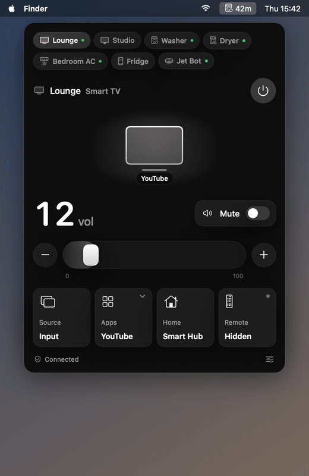

# Samsung SmartThings on Apple

A native macOS menu bar panel for Samsung TVs, smart monitors, washers and dryers.
TVs are controlled directly over the local network; washers and dryers go through the SmartThings cloud API.

<p align="center"></p>

## Features

**TVs and smart monitors (local network, no cloud)**
- Automatic discovery via SSDP/DIAL, re-run every 5 minutes so DHCP address changes are picked up
- Manual "add by IP" for TVs on another subnet
- One-time pairing (press **Allow** on the TV); the pairing token is remembered per device
- Power on (Wake-on-LAN) and off, live power state
- Absolute volume slider and mute (UPnP RenderingControl)
- Shows the app currently on screen, launches installed apps (YouTube, Netflix, Prime Video, …)
- Source, Home and a full remote pad (arrows, OK, back, channel, playback, info, menu)

**SmartThings devices (cloud)**

Every device on your SmartThings account is discovered and gets a panel that fits its type:

| Type | Panel |
|---|---|
| Washer, dryer, dishwasher, oven | Remaining time, progress, phase, finish time; start / pause / stop; cycle, temperature, spin, rinse, dry level, wrinkle prevent, course, oven mode and setpoint; energy use |
| Air conditioner | Room temperature, setpoint slider, mode, fan speed, airflow, Eco and Sleep |
| Refrigerator | Fridge and freezer temperatures with setpoint +/−, Power Cool, Power Freeze, door state, water filter |
| Robot vacuum | Battery, clean / pause / dock, cleaning mode, suction (turbo) |
| Air purifier | PM2.5 / PM10 / PM1.0, air quality, fan mode, filter life |
| Soundbar, speaker, TV without local access | Volume, mute, playback, input source, sound and picture mode |
| Lights, plugs, locks, sensors | Power, brightness, lock / unlock, temperature, humidity, battery, contact, motion, water, power and energy readings |

TVs that are also on SmartThings are linked to their local entry (matched by name), which adds picture mode, sound mode, the real input list, and power-on through the cloud when Wake-on-LAN can't wake the TV.

The menu bar shows the remaining minutes while any appliance runs.

**Notifications**
- *Finished*: washer, dryer, dishwasher, oven and robot vacuum post a macOS notification when the cycle ends. A dryer counts as finished once it enters wrinkle prevent.
- *Almost done*: a heads-up 5 minutes before the end of a cycle.
- *Needs attention*: a robot vacuum that reports an alarm (stuck, error).
- Turn each one on or off in settings; **Test** sends a sample notification. Cancelling a paused cycle doesn't notify.
- Status is polled every 20 seconds while the app runs, so alerts arrive within about 20 seconds of the change.

## Requirements

- macOS 14 or later
- Xcode command line tools (Swift 5.10+)
- For washer/dryer: a SmartThings personal access token

## Install

Download `SmartPanel-1.0.0.dmg` from the [latest release](https://github.com/flightlesstux/SamsungSmartThingsonApple/releases/latest), open it and drag **SmartPanel** to **Applications**.

The app is not notarized. On first launch, right-click SmartPanel in Applications and choose **Open**, or run:

```sh
xattr -dr com.apple.quarantine /Applications/SmartPanel.app
```

When macOS asks whether SmartPanel may use the SmartThings token in your Keychain, choose **Always Allow**.

## Build and run

```sh
git clone https://github.com/flightlesstux/SamsungSmartThingsonApple.git
cd SamsungSmartThingsonApple
./build.sh
open build/SmartPanel.app
```

On first launch:

1. Allow **Local Network** access when macOS asks (System Settings → Privacy & Security → Local Network).
2. Your TVs appear automatically. The first command to each TV shows an **Allow** prompt on its screen; accept it.
3. Allow notifications when macOS asks (System Settings → Notifications → SmartPanel).
4. For SmartThings devices, open settings (sliders icon, bottom right), paste a SmartThings token and press **Save**.
   Create the token at <https://account.smartthings.com/tokens> with these scopes:
   - Devices: list, see, control (`r:devices:*`, `w:devices:*`, `x:devices:*`)
   - Locations: see (`r:locations:*`)

## How it works

| Device | Transport | Used for |
|---|---|---|
| TV | SSDP `M-SEARCH` for `urn:dial-multiscreen-org:service:dial:1` | Discovery |
| TV | `GET http://<tv>:8001/api/v2/` | Model, name, MAC, power state |
| TV | `wss://<tv>:8002/api/v2/channels/samsung.remote.control` (token auth) | Remote keys, app launch fallback |
| TV | `http://<tv>:9197/upnp/control/RenderingControl1` (SOAP) | Volume and mute |
| TV | `GET/POST http://<tv>:8001/api/v2/applications/<appId>` | Foreground app, app launch |
| TV | Wake-on-LAN magic packet, UDP 9 | Power on |
| SmartThings devices | `https://api.smartthings.com/v1` | Discovery, status and commands |

The TV serves a self-signed certificate on port 8002; SmartPanel trusts it only for that TV's own address.

## Storage

- SmartThings token: macOS Keychain (service `com.flightlesstux.SmartPanel`)
- Discovered TVs and pairing tokens: app user defaults

Nothing is sent anywhere except your TVs and the SmartThings API.

## Debug flags

```sh
build/SmartPanel.app/Contents/MacOS/SmartPanel --snapshot <dir>          # render each panel to PNG and exit
build/SmartPanel.app/Contents/MacOS/SmartPanel --send <tv name> KEY_HOME # send one remote key and exit
build/SmartPanel.app/Contents/MacOS/SmartPanel --demo-frames <dir>       # render the demo walkthrough frames
scripts/make-demo-gif.sh                                                 # rebuild docs/demo.gif (needs ffmpeg)
scripts/make-dmg.sh                                                      # build build/SmartPanel-<version>.dmg
```

The demo GIF uses built-in sample devices, so it never shows real device names or addresses.

## Notes

- If the TV sends audio to a soundbar or receiver, its own volume is fixed; use the +/− buttons, which send volume keys over HDMI-CEC.
- Appliance commands are rejected by SmartThings while *Remote Control* is off on the machine.
- Panels are built from the SmartThings capability model, so models that report other capabilities may show fewer controls.

## License

MIT
